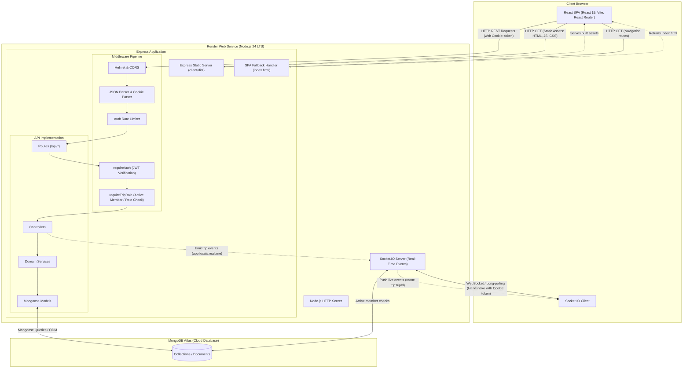

# System Architecture

TripVote is architected as a single-service full-stack web application hosted on Render, backed by a managed MongoDB Atlas cluster. The single service delivers the compiled React client, handles REST API requests, and brokers real-time WebSocket events.

## Architectural Layers

The Express backend strictly enforces separation of concerns across four decoupled layers:

- **Routes (`server/src/routes/`):** Define HTTP resource endpoints and mount middleware. Routes parse no request bodies and execute no database queries; they configure parameter validation, rate limiting, and authentication/authorization gates before routing to controllers.
- **Controllers (`server/src/controllers/`):** Act as request/response adapters. Controllers extract request inputs (`req.params`, `req.body`, `req.user`, `req.membership`), delegate business logic to the service layer, trigger real-time broadcast notifications via `req.app.locals.realtime`, and format HTTP status codes (`200`, `201`, `204`).
- **Services (`server/src/services/`):** House all business logic and domain rules. Services handle algorithms such as fair expense splitting with remainder cent distribution, date overlap aggregation, and vote tallying. They interact directly with Mongoose models and throw structured domain errors (`AppError`) without coupling to Express request/response objects.
- **Models (`server/src/models/`):** Define Mongoose schemas, data validation constraints, and database indexes. Models encapsulate document structure and database persistence rules independently of HTTP transport.

## Authentication and Role-Based Authorization

- **Login Cookies & Session Lifecycle:** Upon successful registration or login via `/api/auth`, the server signs a cryptographically secure JWT containing the user ID and sets it as an `httpOnly`, `Secure` (in production environments), `SameSite=Lax` cookie named `token`. The client browser automatically includes this cookie in all subsequent cross-origin and same-origin HTTP requests and WebSocket handshakes. The `requireAuth` middleware verifies the JWT against the server secret on every protected endpoint and attaches the authenticated user to `req.user`. Similarly, the Socket.IO authentication middleware extracts the cookie during handshake negotiation, verifying credentials before establishing persistent real-time connections. Logging out instructs the client browser to immediately clear the `token` cookie.
- **Member and Role Access Control:** Every trip-scoped route (`/api/trips/:tripId/*`) enforces the `requireTripRole(role?)` middleware. This middleware validates that `tripId` is a valid MongoDB ObjectId, queries `TripMembership` for an active membership associated with `req.user.id`, and populates `req.membership`. If the user is not an active member, the request is rejected with `403 FORBIDDEN` (or `404 NOT_FOUND` for invalid trip IDs), ensuring Viewers cannot read itinerary, availability, or budget data. When an Organizer-specific role is required (e.g., updating trips, approving join requests, setting budgets), the middleware ensures `req.membership.role === 'organizer'`. Fine-grained ownership rules (e.g., members editing only their own activities or expenses) are verified within the service layer. For live updates, sockets are only allowed to join room `trip:<tripId>` after verifying active trip membership in `handleJoin`.
