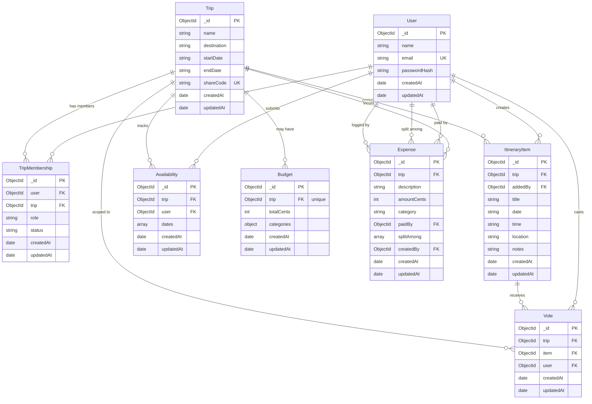

# Database Schema

TripVote uses MongoDB Atlas via Mongoose ODM for data persistence. This document describes the schema design, field constraints, collection indexes, and entity relationships across the system.

## Entity-Relationship Diagram

## Collection Details

### 1. User (`users`)
Represents registered user accounts.
- `_id` (`ObjectId`): Unique MongoDB identifier.
- `name` (`String`, required, trimmed): Display name of the user.
- `email` (`String`, required, unique, lowercase, trimmed): Account email address used for login.
- `passwordHash` (`String`, required, hidden by default with `select: false`): Password hashed with bcrypt (cost factor >= 10).
- `createdAt` / `updatedAt` (`Date`): Managed timestamps.

### 2. Trip (`trips`)
Represents a group trip planned within the app.
- `_id` (`ObjectId`): Unique trip identifier.
- `name` (`String`, required, trimmed): Name of the trip.
- `destination` (`String`, required, trimmed): Location of the trip.
- `startDate` (`String`, required): ISO date string (`YYYY-MM-DD`).
- `endDate` (`String`, required): ISO date string (`YYYY-MM-DD`).
- `shareCode` (`String`, required, unique): Cryptographically random 16-byte hex token (`randomBytes(16).toString('hex')`) used for unguessable invite links.
- `createdAt` / `updatedAt` (`Date`): Managed timestamps.

### 3. TripMembership (`tripmemberships`)
Join model defining a user's role and state within a specific trip.
- `_id` (`ObjectId`): Unique membership identifier.
- `user` (`ObjectId`, ref: `User`, required): Reference to the user.
- `trip` (`ObjectId`, ref: `Trip`, required): Reference to the trip.
- `role` (`String`, enum: `['organizer', 'member']`, required): Authorization role. The creator becomes `organizer`.
- `status` (`String`, enum: `['pending', 'active']`, default: `'active'`, required): Membership state. Join requests create records in `'pending'` status until approved.
- `createdAt` / `updatedAt` (`Date`): Managed timestamps.
- **Index:** Compound unique index on `{ user: 1, trip: 1 }` prevents duplicate memberships or simultaneous join requests.

### 4. ItineraryItem (`itineraryitems`)
Represents a scheduled activity or plan on the shared trip itinerary.
- `_id` (`ObjectId`): Unique activity identifier.
- `trip` (`ObjectId`, ref: `Trip`, required, indexed): Reference to the associated trip.
- `addedBy` (`ObjectId`, ref: `User`, required): User who created the activity.
- `title` (`String`, required, trimmed): Title or name of the activity.
- `date` (`String`, required): Date of the activity (`YYYY-MM-DD`).
- `time` (`String`, required): Time of the activity (`HH:mm`).
- `location` (`String`, optional, trimmed): Location or venue name.
- `notes` (`String`, optional, trimmed): Additional activity details or gear recommendations.
- `createdAt` / `updatedAt` (`Date`): Managed timestamps.
- **Index:** Compound index on `{ trip: 1, date: 1, time: 1 }` optimizes itinerary chronologically sorted queries.

### 5. Vote (`votes`)
Represents member votes cast for itinerary activities.
- `_id` (`ObjectId`): Unique vote identifier.
- `trip` (`ObjectId`, ref: `Trip`, required): Reference to the trip.
- `item` (`ObjectId`, ref: `ItineraryItem`, required): Reference to the activity.
- `user` (`ObjectId`, ref: `User`, required): User who cast the vote.
- `createdAt` / `updatedAt` (`Date`): Managed timestamps.
- **Index:** Compound unique index on `{ item: 1, user: 1 }` guarantees at most one vote per member per activity.

### 6. Availability (`availabilities`)
Stores the free dates indicated by a member for a given trip.
- `_id` (`ObjectId`): Unique availability record identifier.
- `trip` (`ObjectId`, ref: `Trip`, required): Reference to the trip.
- `user` (`ObjectId`, ref: `User`, required): Reference to the member.
- `dates` (`[String]`, default: `[]`): Array of ISO date strings (`YYYY-MM-DD`) within the trip date boundaries.
- `createdAt` / `updatedAt` (`Date`): Managed timestamps.
- **Index:** Compound unique index on `{ trip: 1, user: 1 }` ensures one availability submission per user per trip.

### 7. Budget (`budgets`)
Stores the overarching trip budget and per-category allocations.
- `_id` (`ObjectId`): Unique budget identifier.
- `trip` (`ObjectId`, ref: `Trip`, required, unique, indexed): One-to-one relationship with `Trip`.
- `totalCents` (`Number`, required, min: 0): Total trip budget stored in integer cents (never floats).
- `categories` (`Object`, subdocument without separate `_id`):
  - `lodging` (`Number`, default: 0, min: 0)
  - `food` (`Number`, default: 0, min: 0)
  - `transport` (`Number`, default: 0, min: 0)
  - `activities` (`Number`, default: 0, min: 0)
  - `other` (`Number`, default: 0, min: 0)
- `createdAt` / `updatedAt` (`Date`): Managed timestamps.

### 8. Expense (`expenses`)
Represents an individual expense logged against the trip budget.
- `_id` (`ObjectId`): Unique expense identifier.
- `trip` (`ObjectId`, ref: `Trip`, required, indexed): Reference to the associated trip.
- `description` (`String`, required, trimmed): Description of what was purchased.
- `amountCents` (`Number`, required, min: 1): Expense amount in integer cents.
- `category` (`String`, enum: `['lodging', 'food', 'transport', 'activities', 'other']`, required): Budget category.
- `paidBy` (`ObjectId`, ref: `User`, required): Member who paid for the expense.
- `splitAmong` (`[ObjectId]`, refs: `User`, required): Non-empty list of active trip members sharing the cost.
- `createdBy` (`ObjectId`, ref: `User`, required): User who logged the transaction.
- `createdAt` / `updatedAt` (`Date`): Managed timestamps.
- **Index:** Compound index on `{ trip: 1, createdAt: -1 }` optimizes reverse-chronological expense feeds.
